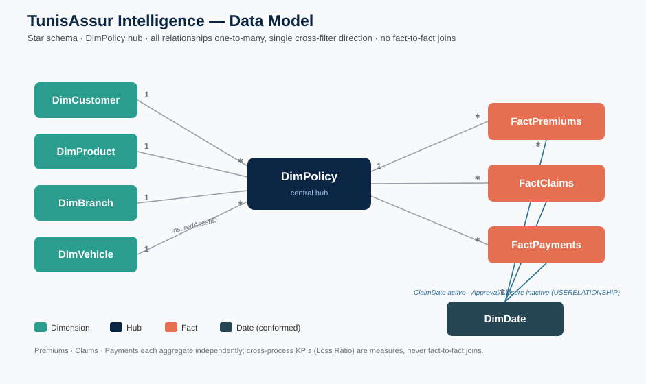

# 🛡️ TunisAssur Intelligence
### Insurance Performance, Customer Intelligence & Claims Risk Analytics

An **end-to-end Business Intelligence project** built on a fictional Tunisian insurer,
*TunisAssur*. It covers the full lifecycle a BI/Data Analyst owns in practice: synthetic data
engineering → data-quality handling → SQL → a star-schema semantic model → a documented DAX
measure library → transparent claims-risk screening → a four-page Power BI report, benchmarked
against the real Tunisian insurance market.

> ⚠️ **Disclaimer** — TunisAssur is **fictional**. Every customer, policy, premium, claim,
> payment and vehicle is **synthetic**, generated with a fixed seed. Real market figures
> (Section *Benchmarks*) are clearly labelled and cited; they are never mixed with company data.



---

## 🧰 Tech stack
**Python** (pandas, numpy) · **PostgreSQL** (Docker) · **SQL** · **Power Query (M)** · **DAX** ·
**Power BI** · **Git/GitHub**

## 📈 Key results (full dataset)
| KPI | Value |
|---|---|
| Customers / Policies | 5,000 / 8,000 |
| Written premium | **13,189,230 TND** |
| Collected premium | 9,754,505 TND |
| Incurred claims (Approved + Pending) | 9,540,610 TND |
| Claims paid | 6,126,660 TND |
| **Loss ratio** | **85.1%** (calibrated "margin pressure") |
| Claims flagged for risk review | 507 (12.7%) |

## 🗂️ Repository structure
```
TunisAssur-Intelligence/
├── data/{raw,cleaned,reference}/   # dirty source · validated truth · curated lookups
├── python/                         # modular generators + validators (seed=42)
├── sql/                            # schema, load, validation, 7 analytical queries, risk
├── documentation/                  # architecture, data dictionary, phase guides, diagrams
├── powerbi/                        # TunisAssur.pbix (built from the guides)
├── screenshots/                    # dashboard screenshots
└── README.md · CLAUDE.md
```

---

## ▶️ How to reproduce

**1. Generate the data** (Python 3.13 + pandas/numpy):
```bash
cd python
python reference_data.py && python generate_branches.py && python generate_customers.py
python generate_policies.py && python generate_premiums.py && python generate_claims.py
python generate_payments.py && python generate_vehicles.py && python generate_dimdate.py
python inject_quality_issues.py && python generate_risk_indicators.py
python validate_data.py            # cleaned/ must PASS
```

**2. PostgreSQL (Docker)** — real server-grade SQL without a native install:
```bash
docker run -d --name tunisassur-pg -e POSTGRES_PASSWORD=TunisAssur2025 \
  -e POSTGRES_DB=tunisassur -p 5432:5432 \
  -v "$(pwd):/project" postgres:17
export MSYS_NO_PATHCONV=1   # Git Bash on Windows
docker exec -w /project tunisassur-pg psql -U postgres -d tunisassur -f sql/schema.sql
docker exec -w /project tunisassur-pg psql -U postgres -d tunisassur -f sql/load_data.sql
docker exec -w /project tunisassur-pg psql -U postgres -d tunisassur -f sql/dim_date.sql
docker exec -w /project tunisassur-pg psql -U postgres -d tunisassur -f sql/risk_indicators.sql
docker exec -w /project tunisassur-pg psql -U postgres -d tunisassur -f sql/data_validation.sql
docker exec -w /project tunisassur-pg psql -U postgres -d tunisassur -f sql/analytical_queries.sql
```

**3. Power BI** — follow the guides in `documentation/`:
Power Query cleaning (05) → data model + DimDate (06) → DAX measures (07) → dashboards (09).

---

## 🏗️ Project phases
| # | Phase | Output |
|---|---|---|
| 0 | Architecture | `documentation/01_data_architecture.md`, star-schema design |
| 1 | Reference data | curated Tunisian governorates, cities, products, names |
| 2 | Data generation | 7 synthetic tables, seed-reproducible, validated |
| 3 | Data quality | 3,544 controlled issues in `raw/` + `validate_data.py` |
| 4 | SQL layer | PostgreSQL schema, load, validation, 7 analytical queries |
| 5 | Power Query | `05_power_query_steps.md` cleaning guide (M code) |
| 6 | Data model | DimDate + relationships + `star_schema.svg` |
| 7 | DAX library | `07_dax_measures.md` — every KPI documented |
| 8 | Risk scoring | transparent rule engine → `FactClaimIndicators` |
| 9 | Dashboards | `09_dashboard_design.md` + Executive wireframe |
| 10 | Benchmarks | real FTUSA market context, cited |

## 📚 Documentation index
Architecture `01` · Data quality `03` · Power Query `05` · Data model `06` · DAX `07` ·
Risk scoring `08` · Dashboards `09` · Benchmarks `10` · **Data dictionary** ·
diagrams (`star_schema.svg`, `dashboard_executive_wireframe.svg`).

---

## 🎯 Skills demonstrated
- **Data engineering:** modular, seeded synthetic generation with business logic & referential integrity.
- **Data quality:** deliberate issue injection + an automated validation suite (ground truth vs dirty source).
- **SQL:** DDL with PK/FK/CHECK, CTEs, window functions, 7 business queries on PostgreSQL.
- **Dimensional modelling:** star schema, conformed DimDate, role-playing dates, **ambiguity-free** design, fan-out-proof multi-fact KPIs.
- **DAX:** financial/claims/customer/time-intelligence/risk measures, each documented with pitfalls.
- **Analytical judgement:** calibrated a realistic loss ratio; transparent, ethical risk screening (not fraud labelling); honest market-benchmark comparison.

## 🧠 Interview talking points
- *Why three fact tables never join* → the loss-ratio fan-out trap and how measures avoid it.
- *Earned vs written vs collected premium* → why loss ratio must use earned/incurred.
- *The model refinement* → routing DimVehicle through DimPolicy to kill ambiguous filter paths.
- *Risk scoring ethics* → screening for human review, documented false-positive/bias limits.

---
*Built as a portfolio project. Data synthetic; market statistics cited from FTUSA/Atlas/UNDP.*
